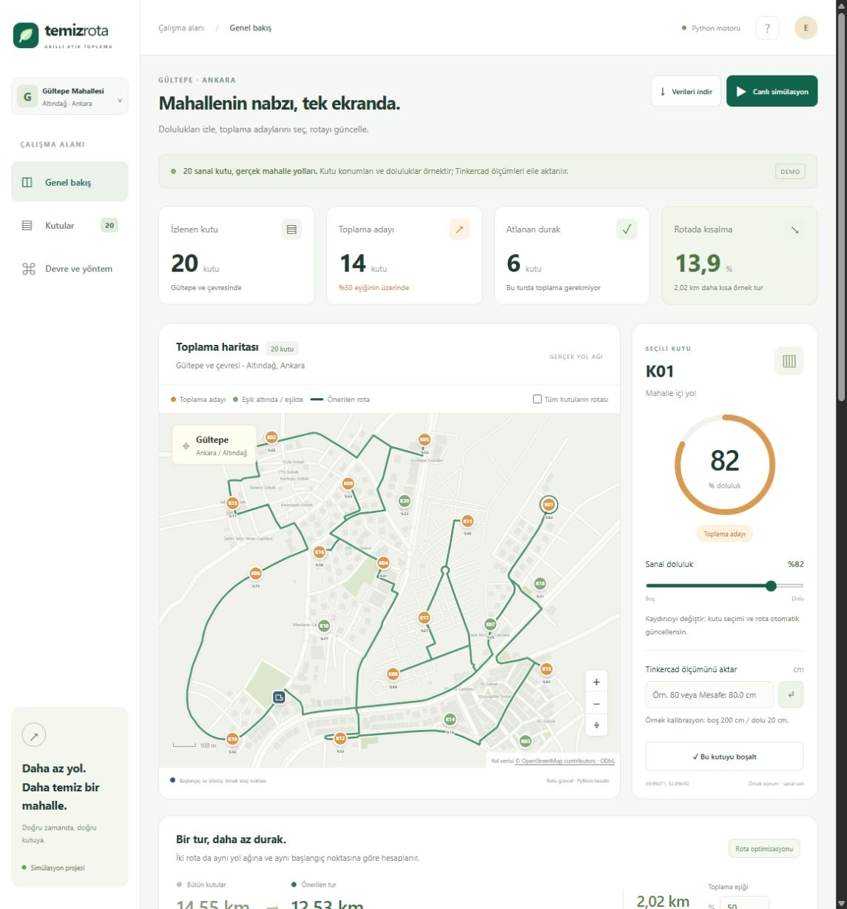
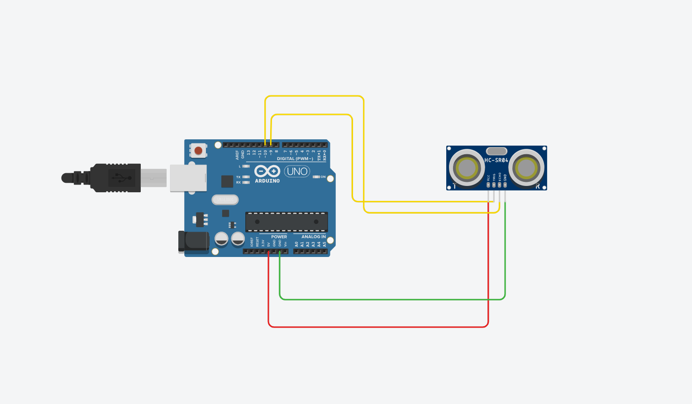
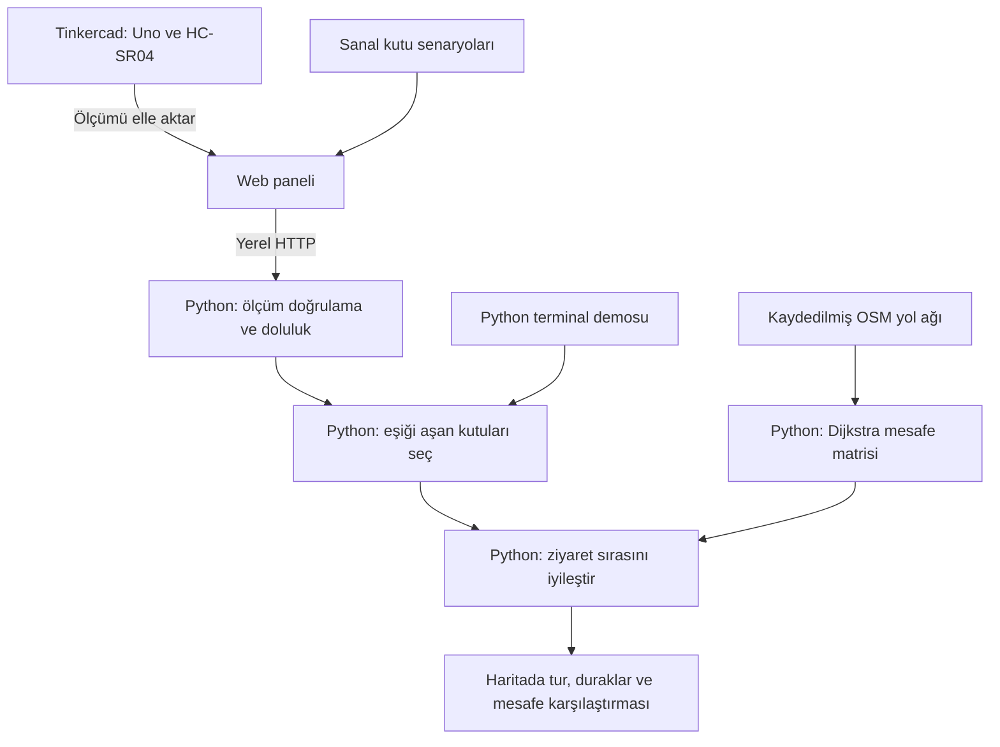

# Temiz Rota — Akıllı Atık Toplama ve Rota Optimizasyonu

**Durum: DEMO / SİMÜLASYON · Python + web paneli + Tinkercad**

Doluluk bilgisine göre toplama gerektiren çöp kutularını seçen ve bu kutular için yol ağı üzerinde tur hesaplayan bir gösterim projesidir. Örnek çalışma alanı **Gültepe Mahallesi ve çevresi, Altındağ / Ankara**; senaryo **20 sanal kutu, %50'nin üzerinde 14 toplama adayı, 6 atlanan durak** içerir.

> **Bu depo, daha kapsamlı bir donanım projesinin yeniden hazırlanmış demosudur.** Proje sahibinin aktarımına göre önceki fiziksel çalışmada **Raspberry Pi 4, mesafe sensörleri, GPS ve Wi‑Fi/haberleşme modülleri** kullanılmıştır. Buradaki sürüm o kurulumun tamamını içermez ve fiziksel cihazlara bağlı çalışmaz. Eski kaynak kodlar mevcut olmadığından bu depodaki Python kodları demo için yeniden yazılmıştır; önceki projenin kurtarılmış Python kodları olarak sunulmaz.

## Python kodlarını inceleyecek öğretmen için

**Ana inceleme noktası [`python/`](python/) klasörüdür.** Sensör hesabı, yol grafiği, Dijkstra, tur iyileştirme, terminal uygulaması ve HTTP API burada bulunur. Web paneli Python sunucusuyla açıldığında ölçüm ve rota sonuçlarını bu çekirdekten alır.

Önerilen okuma sırası ve örnekler: **[Python inceleme rehberi](docs/PYTHON-INCELEME.md)**.

| Sıra | Python dosyası | İncelenecek konu |
| --- | --- | --- |
| 1 | [sensor.py](python/temiz_rota/sensor.py) | Mesafe doğrulama, kalibrasyon, doluluk ve kesin eşik kuralı |
| 2 | [graph.py](python/temiz_rota/graph.py) | OSM yol grafiği, tek yönler, Dijkstra ve yol oluşturma |
| 3 | [routing.py](python/temiz_rota/routing.py) | Çok başlangıçlı en ucuz ekleme ve yönlü 2-opt |
| 4 | [service.py](python/temiz_rota/service.py) | 20 kutuluk senaryo, veri doğrulama ve sonuç raporu |
| 5 | [run_demo.py](python/run_demo.py) | Web arayüzü olmadan çalıştırılabilen terminal demosu |
| 6 | [server.py](python/temiz_rota/server.py) | Web panelinin kullandığı yerel ölçüm ve rota API'si |
| 7 | [test_demo.py](python/tests/test_demo.py) | 24 otomatik test; sınır durumları ve gerçek HTTP istekleri |

## Amaç ve örnek senaryo

Her kutuya aynı turda uğramak yerine doluluk eşiğini aşan kutuların toplama listesine alınması hedeflenir. Daha az toplama durağı ve daha kısa bir tur; zaman, yakıt ve araç kullanımı bakımından fayda sağlayabilir. Bu depoda **ölçülmüş yakıt, süre, emisyon veya araç ömrü sonucu yoktur**; ekranda gösterilen kısalma, yalnızca örnek yol ağı üzerinde hesaplanan mesafe karşılaştırmasıdır.

20 kutunun tümünü ziyaret eden karşılaştırma turu ile yalnızca 14 adayı ziyaret eden tur aynı yol ağı ve aynı başlangıç/dönüş noktası kullanılarak hesaplanır. Varsayılan senaryoda yaklaşık **14,55 km → 12,53 km**, yani **2,02 km / %13,9** daha kısa yol bulunur. Doluluk veya eşik değiştiğinde sonuç yeniden hesaplanır.

Toplama listesine alınmayan kutunun bulunduğu sokaktan geçmek gerekebilir. Atlanan şey o kutudaki toplama durağıdır.



## Kapsamlı fiziksel proje ile bu demo arasındaki ilişki

| Bileşen | Önceki fiziksel proje — proje sahibinin aktarımı | Bu depodaki demo |
| --- | --- | --- |
| Raspberry Pi 4 | Donanım sisteminin parçası | GPIO veya cihaz bağlantısı yok; yazılım bilgisayarda çalışır |
| Mesafe sensörü | Kutu içindeki mesafe üzerinden doluluk | Tinkercad'de Uno + HC-SR04; panelde elle ölçüm girişi |
| GPS | Konumlandırma bileşeni | Gerçek GPS okuması yok; haritada örnek sabit koordinatlar |
| Wi‑Fi / haberleşme modülleri | Verinin iletilmesi için kapsamda | Gerçek kablosuz cihazdan veri alınmaz; tarayıcı–Python iletişimi yerel HTTP ile olur |
| Çöp kutuları | Fiziksel prototip | 20 sanal kutu; belediyenin gerçek kutu envanteri değildir |
| Kodlar | Önceki kaynak kodlara erişilemiyor | Python, JavaScript ve Arduino demo kodları yeniden hazırlanmıştır |

Eski GPS/Wi‑Fi modüllerinin tam modeli, önceki bağlantı şeması ve geçmiş yazılımın ayrıntıları doğrulanmış değildir. Bu demo, o sistemin birebir yeniden üretimi olarak değerlendirilmemelidir.

## Kurulum ve çalıştırma

**Python 3.10 veya üzeri** yeterlidir. Python çekirdeği yalnızca standart kütüphaneyi kullanır; `pip install`, API anahtarı, ücretli servis veya fiziksel donanım gerektirmez. Doğrulama Python 3.14.7 ile yapılmıştır.

Depoyu klonlayıp klasöre geçin:

```sh
git clone https://github.com/Quecc/Akilli-Atik-Toplama-ve-Rota-Optimizasyonu.git
cd Akilli-Atik-Toplama-ve-Rota-Optimizasyonu
```

### Web paneli ve Python motoru

```sh
python python/run_server.py
```

Tarayıcıda [yerel paneli](http://127.0.0.1:4173) açın. Üst çubuktaki **“Python motoru”**, ekrandaki rotanın Python API yanıtından geldiğini gösterir. İlk hesap sırasında kısa süre “Python hesaplıyor” görünebilir.

Windows'ta **`BASLAT.cmd`** dosyasına çift tıklamak da Python sunucusunu arka planda açar ve tarayıcıyı başlatır. Aynı Python sunucusu zaten çalışıyorsa tekrar kullanılır. Arka planda başlatılan sunucuyu kapatmak için Görev Yöneticisi'nde komut satırı `python/run_server.py` olan ilgili işlemi sonlandırın. Terminalden çalıştırıyorsanız **Ctrl+C** yeterlidir.

4173 portu doluysa:

```sh
python python/run_server.py --port 4174
```

Bu durumda [alternatif yerel paneli](http://127.0.0.1:4174) açın. Sunucu yalnızca `127.0.0.1` üzerinde dinler. Harita verisi paketin içindedir; normal kullanım sırasında internet gerekmez. Sunucu üretim ortamına yönelik değildir.

### Yalnızca Python: tarayıcısız inceleme

```sh
python python/run_demo.py --output sonuc.json
python python/run_demo.py --distance 80 --bin K03 --output olcum-sonucu.json
python python/run_demo.py --threshold 100 --output bos-tur.json
```

İlk komut 14 adaylı varsayılan senaryoyu, ikincisi K03'e 80 cm ölçüm uygulanınca oluşan **15 adaylı** senaryoyu, üçüncüsü hiçbir kutunun %100'ün üzerinde olmadığı **0 adaylı** senaryoyu üretir. Sonuç terminale ve belirtilen JSON dosyasına yazılır. Dosyada aday/atlanan kimlikleri, tur sırası, metre cinsinden mesafeler ve yol düğümleri bulunur.

### İsteğe bağlı JavaScript sürümü

Python kullanmadan arayüzü çalıştırmak için Node.js 18 veya üzeriyle `node server.mjs` kullanılabilir. Bu modda hesap JavaScript ile yapılır ve panel bunu **“Tarayıcı hesabı”** olarak belirtir. Python API erişilemezse arayüz aynı JavaScript hesabına geçer; Python çalışıyormuş gibi göstermez. Python incelemesi için yukarıdaki Python komutlarını kullanın.

## Panelde neler denenebilir?

1. Başlangıçta **20 kutu / 14 aday / 6 atlanan durak** değerlerini kontrol edin.
2. Harita veya tablodan bir kutu seçin; kaydırıcıyla %50 ve %51 deneyin. **Tam %50 aday değildir, %51 adaydır.**
3. “Tüm kutuların rotası” ile karşılaştırma çizgisini açın.
4. “Tümü boş” ve “Tümü dolu” senaryolarını deneyin; boş senaryoda önerilen tur 0 km'dir.
5. “Bu kutuyu boşalt” ile yalnızca seçili sanal kutuyu sıfırlayın.
6. “Canlı simülasyon” ile her 3 saniyede bir üretilen sanal değişimi başlatın/durdurun.
7. Kutuları arayın, aday veya eşik altı/eşikte filtresi uygulayın.
8. “Verileri indir” ile koordinatları, dolulukları, eşiği, turu ve kullanılan hesap motorunu JSON olarak indirin.

## Tinkercad devresi ve mesafe aktarımı

Fiziksel Uno gerektirmez. [simulasyon_doluluk.ino](arduino/simulasyon_doluluk/simulasyon_doluluk.ino) kodu, Tinkercad'de Arduino Uno + dört pinli HC-SR04 ile çalıştırılır.

| HC-SR04 | Arduino Uno |
| --- | --- |
| VCC | 5V |
| GND | GND |
| TRIG | D9 |
| ECHO | D10 |



[Tinkercad çalışma bağlantısı](https://www.tinkercad.com/things/7IQvomvfJ6q-shiny-bruticus/editel) düzenleme izni gerektirebilir. Devre görseli ve kaynak kod inceleme için depoda da bulunur.

**Tinkercad ile panel arasında otomatik seri bağlantı yoktur.** Seri monitördeki ölçümü panelde seçili kutunun “Tinkercad ölçümünü aktar” alanına elle girin. `80`, `80,0` veya `Mesafe: 80.0 cm | ...` kabul edilir; sonuç yaklaşık **%66,7** olur.

Örnek kalibrasyon: boş kutu **200 cm**, dolu kutu **20 cm**.

```text
doluluk (%) = 100 × (200 − mesafe_cm) / (200 − 20)
toplama adayı = doluluk > eşik
```

Doluluk %0–100 aralığına sınırlandırılır. 2–400 cm dışındaki mesafeler, hatalı metin, NaN ve sonsuz değerler reddedilir; geçersiz ölçüm kutuyu boş saymaz. **110 cm → tam %50**, **80 cm → yaklaşık %66,7**. Tinkercad etiketindeki `in` inç, `cm` santimetredir; yüzde değildir.

Bu yüzde, sensörün gördüğü yüzey yüksekliğinden hesaplanan **yaklaşık doluluktur**. Düzensiz atık yüzeylerinde gerçek hacim doluluğunu birebir temsil etmez. Fiziksel kullanımda her kutuya uygun kalibrasyon ve saha doğrulaması gerekir. [arduino/doluluk_sensoru/](arduino/doluluk_sensoru/) içindeki fiziksel başlangıç örneği de kalibrasyon yapılmadan doğrulanmış ölçüm sunmaz.

## Yazılım akışı ve rota yöntemi



- Yol grafiğinde ardışık OSM noktalarının Haversine mesafesi kullanılır; tek yönler ve ters tek yönler hesaba katılır.
- Dijkstra, araç başlangıcı ve 20 kutu arasındaki yönlü en kısa yolları bulur. Çizilen tur bu yolların düğümlerini izler.
- Ziyaret sırası **çok başlangıçlı en ucuz ekleme + yönlü 2-opt** ile iyileştirilir. Yönlü grafikte ters çevirmenin maliyeti yeniden hesaplanır. **Küresel optimum garantisi yoktur.**
- Karşılaştırmanın tutarlılığı için aday turda, bütün kutuların turundan seçili kutulara indirgenmiş bir başlangıç da değerlendirilir.
- Bu sürümde **makine öğrenmesi modeli yoktur**. Rota optimizasyonu algoritmiktir. Geçmiş doluluk verisinden dolma zamanı tahmini, veri toplandıktan sonra ayrı bir geliştirme olabilir.

Araç kapasitesi, birden fazla kamyon, trafik, zaman pencereleri, dönüş yasakları, bariyerler ve kamyona özel yol kısıtları uygulanmaz. Çıktı sahada sürüş talimatı olarak kullanılacak navigasyon değildir.

## Testler ve doğrulama

```sh
python python/run_tests.py
```

**24 Python testi**; sensör/kalibrasyon, %50 sınırı, tek yön, ulaşılamayan yol, asimetrik tur, 21 nokta arasındaki **441 yolun** mevcut yönlü kenarları izlemesi, eksik/yinelenmiş veri ve gerçek HTTP API isteklerini kapsar. Node.js kuruluysa ayrıca Python ve JavaScript sonuçları aynı veri üzerinde karşılaştırılır; kurulu değilse yalnızca bu karşılaştırma testi atlanır.

İsteğe bağlı JavaScript testleri:

```sh
node --test tests/route-engine.test.cjs
```

**7 JavaScript testi** bulunur. Çalıştırma ve tarayıcı doğrulamasının kapsamı: [DOGRULAMA.md](docs/DOGRULAMA.md). Tinkercad/Arduino kanıtları ayrı tutulur: [ARDUINO-DOGRULAMA.md](docs/ARDUINO-DOGRULAMA.md). Fiziksel Raspberry Pi, GPS veya Wi‑Fi bağlantısı bu sürümde test edilmemiştir.

## Dosya düzeni

```text
python/               Python çekirdeği, terminal demosu, yerel sunucu ve testler
arduino/              Tinkercad kodu ve fiziksel kurulum için başlangıç örneği
data/                 Kaydedilmiş OSM verisi: eşdeğer JSON ve tarayıcı JS sürümü
docs/                 Python inceleme rehberi, doğrulama kayıtları ve görseller
tests/                JavaScript çekirdek testleri
scripts/              İsteğe bağlı harita yenileme betiği
index.html            Türkçe web arayüzü
app.js / styles.css   Panel davranışı ve görünüm
route-engine.js       Tarayıcıda çalışan alternatif hesap motoru
BASLAT.cmd / .ps1     Windows Python başlatıcısı
server.mjs            İsteğe bağlı Node.js statik sunucusu
```

## Geliştirme yönü

1. Gerçek donanım envanterini ve kutu bazlı kalibrasyonu doğrulamak.
2. Raspberry Pi üzerinden sensör okuma, zaman damgası ve bağlantı durumunu kaydetmek.
3. Doğrulanmış GPS konumlarını ve Wi‑Fi üzerinden cihaz verisini sisteme aktarmak.
4. Hatalı/eskimiş ölçüm durumunu ve çevrimdışı verileri ayrı yönetmek.
5. Kamyon kapasitesi, çalışma saatleri ve gerçek yol kısıtlarını eklemek.
6. Toplanan geçmiş verilerle dolma zamanı tahminini değerlendirmek; gerçek mesafe, süre ve yakıt sonuçlarını ölçmek.

Bu maddeler mevcut özellik olarak sunulmaz; kapsamlı donanım sürümüne ilerlerken yapılacak çalışmalardır.

## Harita, kaynaklar ve lisans

Harita **Gültepe ve çevresinin gerçek OSM yollarını** gösterir; çizilen alan resmî mahalle sınırı değildir. Örnek kutuların ve araç başlangıcının gerçek belediye envanteriyle ilişkisi yoktur. Veride 258 yol, 1552 yol düğümü, 354 bina geometrisi ve 10 park/bahçe/spor alanı geometrisi bulunur. Sorgu, kaynak ve zaman bilgileri veri dosyalarında korunur.

Harita verisi **© OpenStreetMap contributors**, [Open Database License 1.0](https://opendatacommons.org/licenses/odbl/1-0/) kapsamındadır. Ayrıntılar: [OSM telif ve lisans](https://www.openstreetmap.org/copyright), [veri açıklaması](data/README.md). Harita yenilemek için internet gerektiren `node scripts/refresh-map.mjs` kullanılabilir; JSON ve JS dosyalarını birlikte günceller.

- Yol verisi alma yöntemi: [Overpass API](https://wiki.openstreetmap.org/wiki/Overpass_API).
- Konum başvurusu: [Gültepe Mahallesi, Altındağ / Ankara](https://www.haritamap.com/yer/gultepe-mahallesi2-altindag).
- HC-SR04 teknik başvurusu: [sensör veri sayfası](https://cdn.sparkfun.com/datasheets/Sensors/Proximity/HCSR04.pdf).

Kod için ayrıca bir dağıtım lisansı henüz seçilmemiştir; harita verisinin ODbL koşulları bundan bağımsızdır.

## English overview

This repository is a **reconstructed software demo**, not the complete historical hardware project. According to the project owner, the broader project used Raspberry Pi 4, distance sensors, GPS and Wi‑Fi/communication modules. The Python source here was newly written for this demo; original source files were unavailable. It provides sensor validation, fill estimation, directed road routing, tour improvement, a local HTTP API and automated tests. The interface uses 20 simulated bins around Gültepe, Ankara, with cached OpenStreetMap roads. There is no live hardware connection or machine learning model in this version. Start with the [Python review guide](docs/PYTHON-INCELEME.md).
