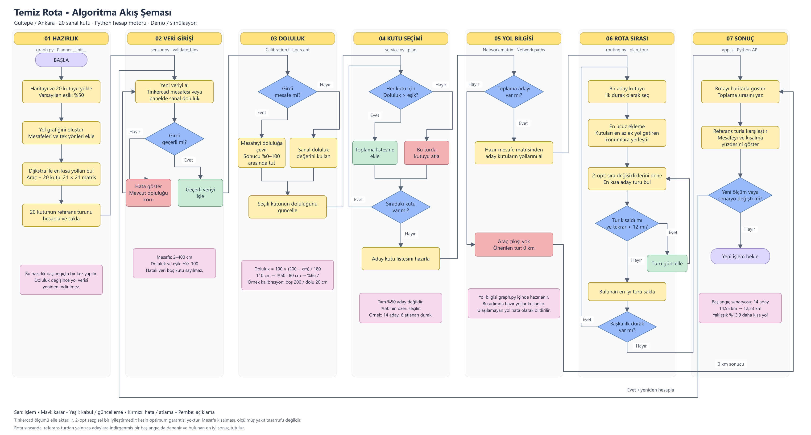

# Algoritma akışı

Şema, Python ile çalışan demodaki işlemleri soldan sağa gösteriyor. Sarı kutular işlemleri, mavi elmaslar kararları gösterir. Kırmızı kutularda hata veya atlama, yeşil kutularda kabul ve güncelleme var.

[](algoritma-akis-semasi.svg)

[SVG'yi aç](algoritma-akis-semasi.svg) · [PNG'yi aç](algoritma-akis-semasi.png) · [draw.io kaynağı](algoritma-akis-semasi.drawio)

## Şemadaki adımlar

| Adım | Ne yapılıyor? | Kod |
| --- | --- | --- |
| Hazırlık | OSM verisi, yönlü yol ağı, 21 × 21 mesafe matrisi ve referans tur hazırlanır. | [graph.py](../python/temiz_rota/graph.py), [Planner.__init__](../python/temiz_rota/service.py) |
| Veri girişi | Mesafe, doluluk ve eşik kontrol edilir. Hatalı ölçüm mevcut değeri bozmaz. | [sensor.py](../python/temiz_rota/sensor.py), [validate_bins](../python/temiz_rota/service.py) |
| Doluluk | Mesafe yüzdeye çevrilir veya paneldeki sanal yüzde kullanılır. | [fill_percent](../python/temiz_rota/sensor.py), [app.js](../app.js) |
| Kutu seçimi | Her kutu için `doluluk > eşik` kuralı uygulanır. | [plan](../python/temiz_rota/service.py) |
| Yol bilgisi | Aday yoksa tur 0 km olur. Aday varsa hazırlanmış mesafe matrisi kullanılır. | [service.py](../python/temiz_rota/service.py) |
| Rota sırası | En ucuz ekleme ve yönlü 2-opt ile ziyaret sırası iyileştirilir. | [routing.py](../python/temiz_rota/routing.py) |
| Sonuç | Tur çizilir, mesafeler karşılaştırılır. Yeni veri geldiğinde hesap yenilenir. | [app.js](../app.js) |

Yol ağı başlangıçta bir kez hazırlanır. Her ölçüm geldiğinde Dijkstra baştan çalıştırılmaz. Aday kutular aynıysa önbellekteki tur kullanılabilir.

Şemadaki %50, varsayılan eşiktir; panelden değiştirilebilir. Tam eşikteki kutu seçilmez. Tinkercad ölçümü elle aktarılır; kaydırıcı doğrudan sanal doluluk verir.

Rota bölümünde, referans turun yalnızca adaylara indirgenmiş hali de başlangıç olarak değerlendirilir. 2-opt adımında en iyi değişiklik her turda aranır, en fazla 12 tur yapılır. Şema normal hesap akışını gösterir; sunucunun bütün HTTP hata kodları ve arayüzün JavaScript alternatifi ayrıca [Python rehberinde](PYTHON-INCELEME.md) açıklanır.

## Şemayı düzenlemek

`algoritma-akis-semasi.drawio` dosyası diagrams.net / draw.io ile açılabilir. Kutular ve bağlantılar ayrı ayrı düzenlenebilir. SVG yakınlaştırıldığında net kalır; PNG, belgeye veya sunuma eklemek için kullanılabilir.

SVG ve draw.io dosyalarını yeniden üretmek için:

```sh
python scripts/ciz_akis_semasi.py
```

Bu komut yalnızca Python'un standart kütüphanesini kullanır. PNG önizlemesi ayrıca dışa aktarılmalıdır.
